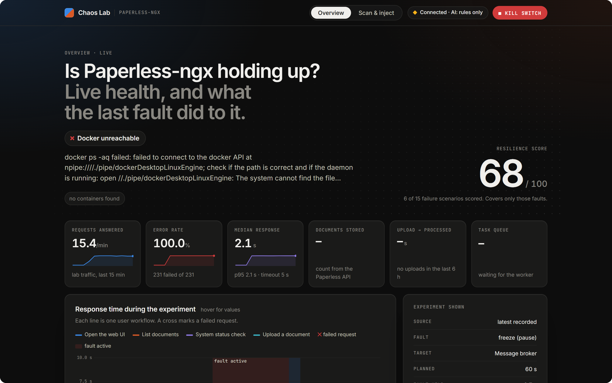
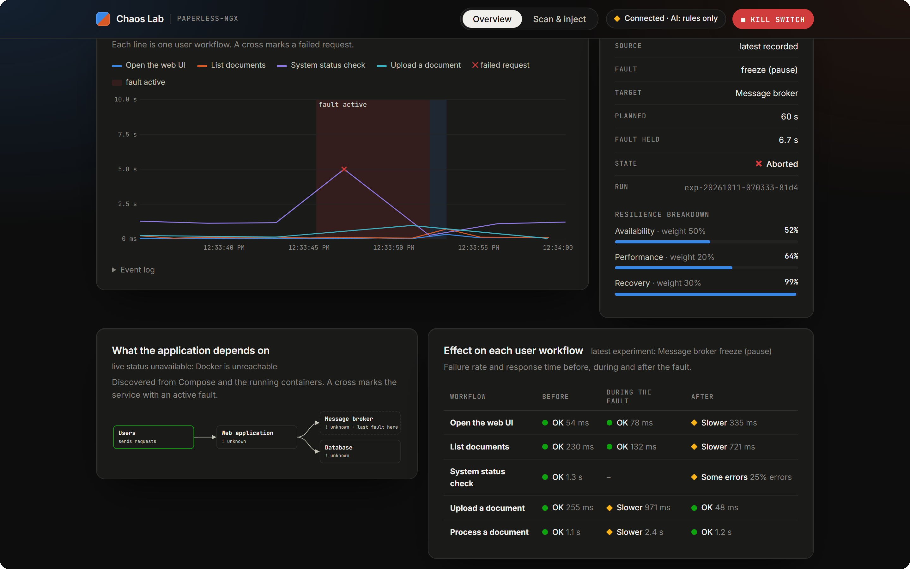
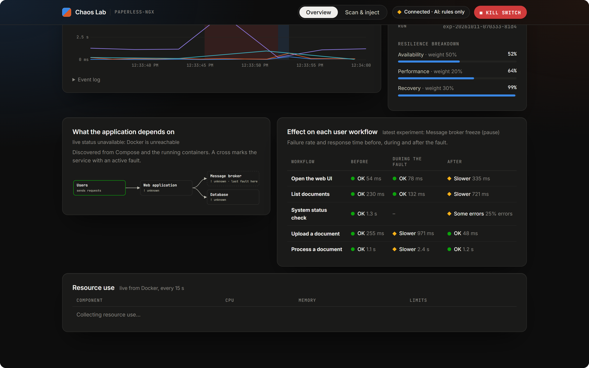
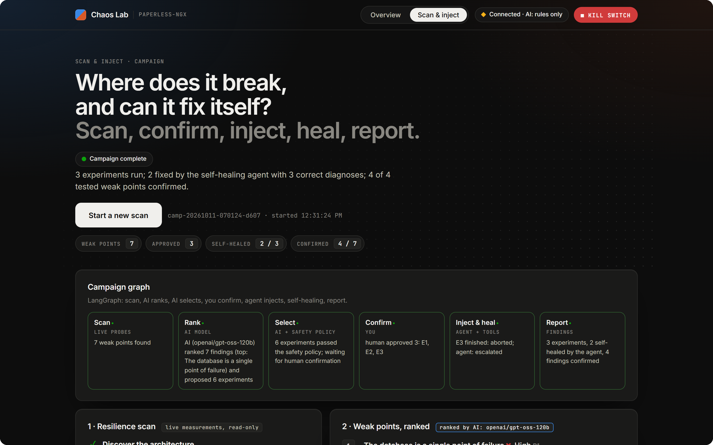
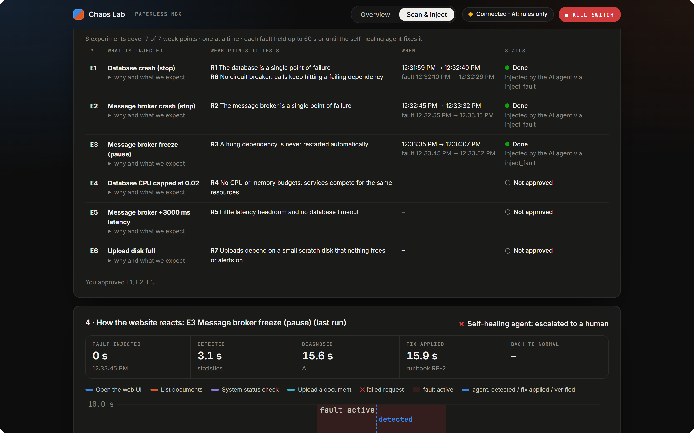
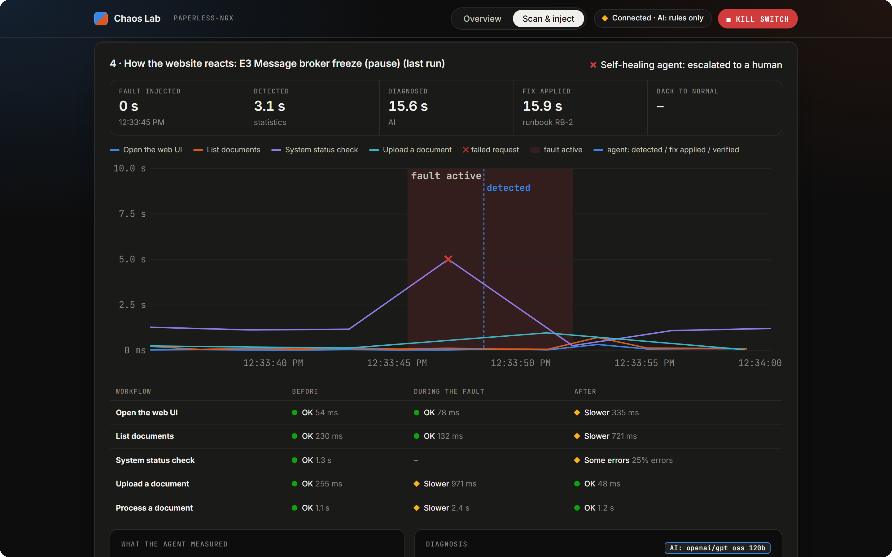
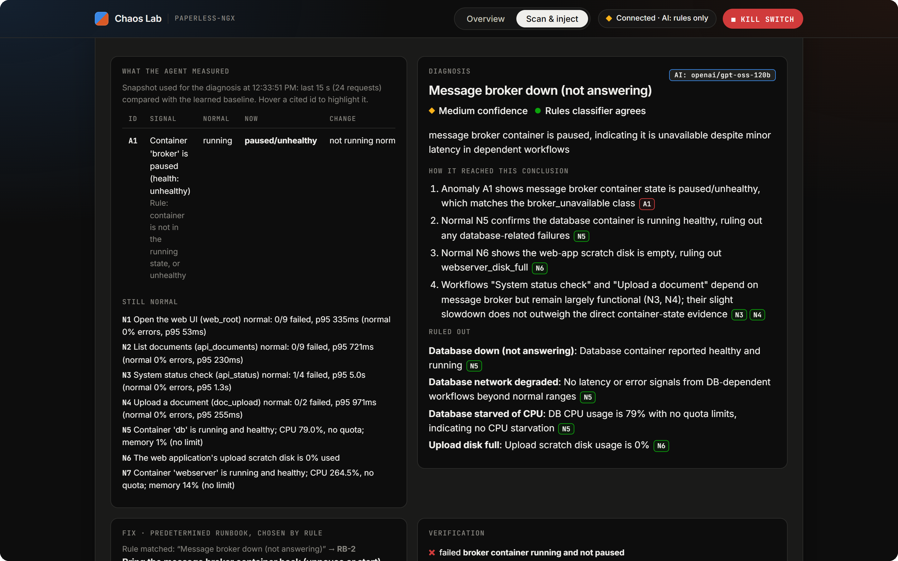
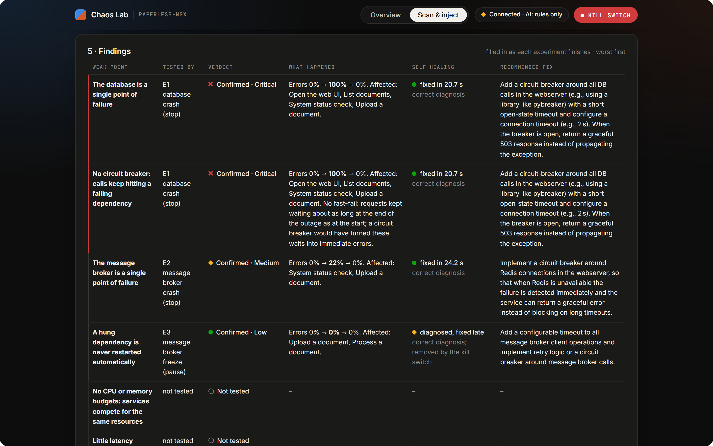
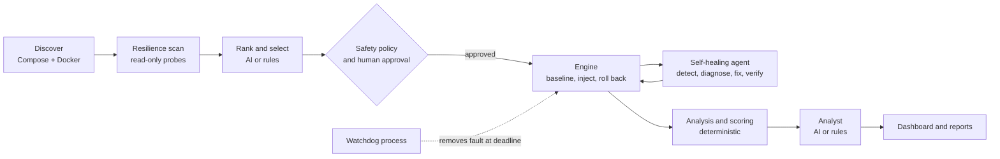

# Resilience Testing Lab

*Formerly Paperless-ngx Chaos Lab (repo `chaos-paperless`). The system under test is Paperless-ngx.*

**When a dependency of a real document system fails, what breaks for users, and can an agent fix it without being told what went wrong?**

This is a chaos-engineering prototype built during the Bosch hackathon (Oct 2026). It runs [Paperless-ngx](https://github.com/paperless-ngx/paperless-ngx) (GPL-3.0) in an isolated Docker Compose sandbox with PostgreSQL and Valkey, sends it a fixed synthetic workload, injects one bounded and reversible fault at a time, and measures the effect on five user workflows. All the data is generated by the lab itself: synthetic documents and probe requests, stored in a local SQLite file. The tools are open source (FastAPI, LangGraph, Docker); the AI model is optional and every agent falls back to deterministic rules.



## Contents

- [Results at a glance](#results-at-a-glance)
- [Why this project exists](#why-this-project-exists)
- [Quick start](#quick-start)
- [The product walkthrough](#the-product-walkthrough)
- [How it works](#how-it-works)
- [Key findings](#key-findings)
- [How far to trust the results](#how-far-to-trust-the-results)
- [Output files](#output-files)
- [Project structure](#project-structure)
- [Testing](#testing)
- [Differences from the original plan](#differences-from-the-original-plan)
- [Future work](#future-work)
- [Tech stack](#tech-stack)
- [References](#references)
- [Project details](#project-details)

## Results at a glance

All figures come from the 43 experiment records in `data/chaos.sqlite3`, made on 2026-10-10 and 2026-10-11 against the live sandbox on one Windows 11 machine. There is no held-out test set: these are repeated measurements of one sandbox under one synthetic workload.

| Measure | Result |
|---|---|
| Overall resilience score (latest run per scenario) | **67.5 / 100** |
| Failure scenarios the score covers | **6 of 15** (the other 9 have never been injected live) |
| Self-healing incidents resolved by the agent | **26 of 27** (the other was ended by an operator's kill switch) |
| Correct failure class, graded against what was injected | 27 of 27 (AI 12 of 12, rules 15 of 15) |
| Time from injection to detection | median **3.1 s** (range 2.9 to 13.4 s, 27 incidents) |
| Time from injection to verified normal service | median 20.9 s (range 14.0 to 28.8 s, 26 incidents) |
| Application recovery after the fault was removed | median 0.8 s, worst 2.5 s (41 runs, none unverified) |
| Worst scenario | database crash: severity 80.4 (critical), resilience 36.7 |
| Experiments recorded | 43: 32 completed, 9 aborted, 2 rejected by the safety policy |
| Automated tests | 178 passed |

Read these with [How far to trust the results](#how-far-to-trust-the-results). In particular, the rules classifier matched the AI model on every incident, so these numbers show no advantage for the AI.

## Why this project exists

Chaos tooling usually answers "did the container survive?". A user of a document system asks something else: can I still open, list and upload documents? This lab measures the second question by running real application requests before, during and after a fault, using the method from the [`testing-chaos`](https://www.skills.sh/wojons/skills/testing-chaos) skill: a hypothesis, a baseline, a small contained fault, automatic rollback and verification afterwards.

It also tests a narrower idea: can AI help in this loop without being trusted with control? The models here propose and interpret. They rank weak points, pick from a validated list of experiments and name a failure class, citing the measurements behind each step. Code decides everything that touches the system: a safety policy approves experiments, a human confirms them, and a fixed rule table chooses the fix.

## Quick start

### 1. Prerequisites

| Need | Notes |
|---|---|
| Docker Desktop (WSL2 backend) or Docker Engine with Compose v2 | `docker version` must show a **Server** section. Recorded runs used Docker Desktop 4.94, engine 29.8.2 |
| Python 3.11 or newer | Tested with 3.13.9 |
| About 3 GB of disk | The Paperless image is about 1.5 GB |

On Windows, install WSL2 first (`wsl --install`, then reboot), then install and start Docker Desktop.

All recorded runs were on Windows 11. The macOS/Linux commands below are the same steps translated, and were not run for this README.

| Package | Version | Used for |
|---|---|---|
| `fastapi` | 0.115.12 | Controller API and dashboard hosting |
| `uvicorn` | 0.34.2 | ASGI server |
| `httpx` | 0.28.1 | Paperless and LLM HTTP clients |
| `pydantic` | 2.11.4 | Strict validation of experiments and AI output |
| `PyYAML` | 6.0.2 | Reading the Compose file |
| `langgraph` | 1.2.12 | Campaign and self-healing graphs |
| `langchain-core` | 1.6.9 | The `inject_fault` tool (installed through `langgraph`) |
| `pytest` | 8.3.5 | Tests |
| Paperless-ngx | 3.2.1, pinned by digest | Application under test |
| PostgreSQL / Valkey | 18 / 9-alpine | Its database and message broker |

### 2. Install

Windows (PowerShell):

```powershell
cd resilience-testing-lab
python -m venv .venv
.venv\Scripts\pip install -r requirements.txt
```

macOS/Linux:

```bash
cd resilience-testing-lab
python3 -m venv .venv
.venv/bin/pip install -r requirements.txt
```

### 3. Get the data

There is no dataset to download. `up` generates the sandbox secrets, builds the fault helper image, starts the stack and waits until it is healthy. `seed` uploads three synthetic documents through the real API and waits until Paperless has processed them.

Windows:

```powershell
.venv\Scripts\python -m chaos up
.venv\Scripts\python -m chaos seed
.venv\Scripts\python -m chaos status
```

macOS/Linux:

```bash
.venv/bin/python -m chaos up
.venv/bin/python -m chaos seed
.venv/bin/python -m chaos status
```

Every check in `status` should say PASS. The Paperless UI is at http://localhost:8000; the user is `chaosadmin` and the password is in `sandbox/.env`.

### 4. Run the pipeline

The usual route is the dashboard (step 5), which runs the whole campaign. The same engine is available from the command line:

Windows:

```powershell
.venv\Scripts\python -m chaos baseline --duration 30
.venv\Scripts\python -m chaos run --target broker --duration 20 --max-error-rate 0.6 `
    --hypothesis "Reads keep working while the broker is frozen; uploads stall and recover after unpause"
.venv\Scripts\python -m chaos report latest
```

macOS/Linux:

```bash
.venv/bin/python -m chaos baseline --duration 30
.venv/bin/python -m chaos run --target broker --duration 20 --max-error-rate 0.6 \
    --hypothesis "Reads keep working while the broker is frozen; uploads stall and recover after unpause"
.venv/bin/python -m chaos report latest
```

Other commands: `plan`, `plan-run`, `analyze`, `score`, `export`, `retest`, `runs`, `kill`, `rollback`, `unblock`. `python -m chaos <command> --help` lists the options.

### 5. Open the app

Windows:

```powershell
.venv\Scripts\python -m chaos serve
```

macOS/Linux:

```bash
.venv/bin/python -m chaos serve
```

Then open http://127.0.0.1:8800.

### Choosing an AI model

| `CHAOS_LLM_PROVIDER` | Needs | Model setting (default) |
|---|---|---|
| `ollama` | A local [Ollama](https://ollama.com) server | `CHAOS_OLLAMA_MODEL` (`llama3.1`), `CHAOS_OLLAMA_URL` |
| `anthropic` | `pip install anthropic` and `ANTHROPIC_API_KEY` | `CHAOS_ANTHROPIC_MODEL` (`claude-opus-5-5`) |
| `openai` | Any OpenAI-compatible `/chat/completions` endpoint | `CHAOS_OPENAI_MODEL`, `CHAOS_OPENAI_URL`, `OPENAI_API_KEY` |
| `none` | Nothing | Deterministic rules only |
| `auto` (default) | First available of Anthropic key, local Ollama, OpenAI key | |

If no provider is set, or one fails or returns something invalid, the agents fall back to rules. Their output is labelled `rules` or `rules-fallback` wherever it appears. Measurements, classification and scores do not depend on the provider.

Two Windows helpers read a key from a user environment variable and start the dashboard: [`serve-groq.ps1`](serve-groq.ps1) (`GROQ_API_KEY`, default model `openai/gpt-oss-120b`) and [`serve-gemini.ps1`](serve-gemini.ps1) (`GEMINI_API_KEY`). The recorded AI campaigns used the Groq route.

### Fast mode

`CHAOS_SPEED=fast` shortens the fixed waits for a live demo. [`serve-groq.ps1`](serve-groq.ps1) turns it on by default.

| Setting | Normal | Fast |
|---|---|---|
| Baseline before injection | 15 s | 10 s |
| Observation after recovery | 10 s | 3 s |
| Longest a fault is held for the agent | 90 s | 60 s |
| Pause between experiments | 5 s | 2 s |
| Live requests per workflow in the scan | 5 | 3 |

The workload, safety limits, abort thresholds, the 5 s request timeout and the recovery checks do not change. The shorter baseline has fewer samples, so use normal speed for results you intend to report.

### Shutting down

```powershell
.venv\Scripts\python -m chaos down             # rolls back any fault, then stops the stack (data kept)
.venv\Scripts\python -m chaos down --volumes   # also wipes Paperless data
Remove-Item -Recurse data                      # wipes recorded experiments (optional)
```

```bash
.venv/bin/python -m chaos down                 # rolls back any fault, then stops the stack (data kept)
.venv/bin/python -m chaos down --volumes       # also wipes Paperless data
rm -r data                                     # wipes recorded experiments (optional)
```

### Troubleshooting

| Symptom | Fix |
|---|---|
| `docker CLI not found` or `Docker engine not reachable` | Start Docker Desktop and wait for "Engine running", or set `CHAOS_DOCKER_BIN` to the full path of `docker.exe` |
| `compose up` times out on first start | Run `docker compose -p paperless-chaos -f sandbox/docker-compose.yml pull`, then `python -m chaos up` again |
| Preflight fails on `webserver running, not paused, healthy` | Paperless is still migrating on first boot (start period 120 s). Wait, then run `python -m chaos status` |
| Dashboard banner **Experiments blocked** | Run `python -m chaos rollback`, check `docker ps`, then click **Verify environment & unblock** or run `python -m chaos unblock` |
| A container stays paused after a crash | `python -m chaos rollback` works without the server; or `docker unpause paperless-chaos-db-1` |
| `network_latency` preflight fails on the netem helper image | `python -m chaos up` rebuilds `chaos-netem:local` (needs Docker Hub access for `alpine:3.20`) |
| Port 8000 or 8800 in use | Change the published port in `sandbox/docker-compose.yml` and set `CHAOS_PAPERLESS_URL`, or run `python -m chaos serve --port 8801` |
| Token errors | Run `python -m chaos down --volumes`, then `up`. The admin is created on first boot from `sandbox/.env` |

## The product walkthrough

These screenshots show the last recorded campaign, `camp-20261011-070124-d607`. They were taken with Docker stopped, so live panels say "Docker unreachable", the top bar says "AI: rules only", and the live tiles show 100% errors because the always-on monitor's probes are failing against a stopped sandbox. The dashboard never fills a missing value with a guess. Experiment data on these pages is real; it comes from the database.

### Overview: is the application holding up?


The page opens with one verdict sentence, the state of each component and the resilience score, stated with its coverage. Six tiles below give a 15-minute trend for requests, error rate, median response, documents, upload-to-processed time and queue length.

### Overview: what did the last fault do to response times?



Each line is a user workflow. The fault window is shaded, the recovery window has its own tint, and a cross marks each failed request, so a failure is visible without relying on colour. The rail beside the chart lists the facts of that experiment and the resilience breakdown.

### Overview: what depends on what, and which workflows suffered?



The dependency map is discovered from Compose and the running containers, not drawn by hand. The table compares each workflow before, during and after the fault, using the fault-phase samples of the experiment shown.

### Scan & inject: where does it break?



One button runs the campaign. The key figures summarise it: 7 weak points, 3 experiments approved, 2 of 3 self-healed, 4 of 7 weak points confirmed. The graph below shows who decided each step: live probes, the AI, the safety policy, you, or the agent.

### Scan & inject: what will be injected, and did you agree?



Each experiment comes from the tests the scan suggested for a weak point and has passed the safety policy. The graph pauses until you approve at least three. In this campaign E1 to E3 were approved and E4 to E6 were declined, so they show **Not approved**.

### Scan & inject: how did the website react?



This section follows the running or latest experiment. The strip above the chart gives the time to detect, diagnose, fix and return to normal, and the chart marks those moments. This run shows the one incident that did not self-heal; see [Key findings](#key-findings).

### Scan & inject: how did the agent reach its conclusion?



The left panel holds the numbered measurements the agent saw. The right panel holds its diagnosis, with each reasoning step citing those ids; hovering a citation highlights the measurement. Answers citing ids that do not exist are rejected before they reach this page.

### Scan & inject: what did we learn?



There is one row per weak point, worst first. Recommended fixes are hypotheses from black-box measurement. Nothing here is applied to the application, and weak points without an approved experiment stay **Not tested**.

## How it works



### 1. Sandbox ([sandbox/docker-compose.yml](sandbox/docker-compose.yml))

**Inputs:** the Compose file and generated secrets. **Outputs:** three containers (webserver, db, broker) in project `paperless-chaos`, labelled `chaos.sandbox=true`.

Paperless is pinned by digest so results refer to one exact build. It is published on 127.0.0.1 only, the database and broker publish no ports, and all containers run with `no-new-privileges`. Secrets are generated per sandbox and gitignored.

### 2. Discovery ([chaos/discovery.py](chaos/discovery.py))

**Inputs:** the Compose file and `docker inspect`. **Outputs:** a dependency graph with evidence for each edge.

Edges are declared (`depends_on`) or inferred (`PAPERLESS_DBHOST`, `PAPERLESS_REDIS`, published ports). The planner works from this map rather than from assumptions about the application.

### 3. Workload ([chaos/workload.py](chaos/workload.py), [chaos/paperless_client.py](chaos/paperless_client.py))

**Inputs:** the running application. **Outputs:** timestamped samples per probe and phase.

| Probe | Call | Every | Exercises | Criticality |
|---|---|---|---|---|
| `web_root` | `GET /` | 2 s | Web server, session, database | 0.20 |
| `api_documents` | `GET /api/documents/` | 2 s | Database read path | 0.30 |
| `api_status` | `GET /api/status/` | 4 s | Paperless' own database and Redis checks | 0.05 |
| `doc_upload` | `POST /api/documents/post_document/` | 8 s | Redis and Celery enqueue | 0.25 |
| `doc_processing` | Upload until task `success` | per upload | Worker, parser, database write | 0.20 |

Every probe has a 5 s timeout and its own thread, so a hung dependency shows up as timed-out probes instead of stalling the workload. Probing faster was tried and rejected: a failing request takes 5 s to time out while successes return at once, so a higher rate dilutes the fault-phase error rate.

### 4. Faults ([chaos/faults.py](chaos/faults.py), [chaos/docker_ops.py](chaos/docker_ops.py))

**Inputs:** a validated experiment. **Outputs:** an applied fault whose removal is verified against the real container state.

| Fault | Parameter | Injection | Removal | Injected live? |
|---|---|---|---|---|
| `dependency_pause` | | `docker pause` | `docker unpause` | Yes |
| `dependency_stop` | | `docker stop` | `docker start` | Yes |
| `network_latency` | `latency_ms` 10 to 3000 | netem sidecar `delay` | Remove sidecar, `tc qdisc del` | Yes |
| `packet_loss` | `loss_pct` 1 to 60 | netem sidecar `loss` | Remove sidecar, `tc qdisc del` | No recorded run |
| `cpu_exhaustion` | `cpu_limit` 0.02 to 0.5 | `docker update` CPU quota | `docker update --cpu-quota -1` | No recorded run |
| `connection_refused` | | iptables sidecar rejects the service port | Remove sidecar, delete the `CHAOS` chain | No recorded run |
| `memory_exhaustion` | `memory_mb` 6 to 256 | `docker update --memory` | Recreate the container from Compose | No recorded run |
| `disk_exhaustion` | | Fill the 64 MB tmpfs upload scratch volume | Delete the fill file | No recorded run |

The database and broker allow the first seven faults. The webserver only allows filling its scratch volume, which lives in memory and cannot touch the host disk. That gives 15 scenarios. [docker_ops.py](chaos/docker_ops.py) is the only module that runs Docker, always with fixed argument lists and never a shell.

### 5. Experiment engine ([chaos/engine.py](chaos/engine.py), [chaos/models.py](chaos/models.py))

**Inputs:** an `ExperimentConfig`. **Outputs:** a persisted run with per-phase metrics, events, logs and an outcome.

1. **Validate.** Unknown fields are rejected and `validate_config` enforces the allowlist and limits.
2. **Preflight.** Docker is reachable, all services are healthy, no leftover sidecars, the target carries the sandbox label, and real application probes succeed.
3. **Baseline.** 15 s of workload immediately before injection.
4. **Inject.** The active-fault marker is written first, then the fault is applied and a watchdog process starts. Each second the engine evaluates rolling error rate and p95 latency, and checks for a kill request.
5. **Roll back** in a `finally` block, then verify removal against the real container state. If that fails, an emergency sweep runs; if it still fails, experiments are BLOCKED.
6. **Check recovery.** The target is healthy and consecutive `api_documents` and `api_status` probes succeed, and the newest sample of each must be good.
7. **Observe** for 10 s more while in-flight processing drains, then persist everything.

### 6. Safety ([chaos/safety.py](chaos/safety.py), [chaos/watchdog.py](chaos/watchdog.py), [chaos/config.py](chaos/config.py))

**Inputs:** every request and every running fault. **Outputs:** accepted or rejected experiments, aborts, and a persisted BLOCKED flag.

These controls work without the dashboard:

- **Allowlist.** Only the sandbox services, in the sandbox project, with the sandbox label. Every container operation re-checks this.
- **Hard limits.** Duration 5 to 120 s and latency 10 to 3000 ms, among others. Values outside the limits are rejected, not clamped.
- **Automatic abort** on a rolling error-rate or p95 breach.
- **Kill switch.** The dashboard button, `POST /api/kill`, `python -m chaos kill` or Ctrl-C. It runs an emergency sweep immediately and does not wait for the experiment thread.
- **Independent watchdog.** A detached OS process removes the fault at planned end plus 10 s (plus another 60 s for memory faults, because removal recreates the container) if the controller has not recorded removal.
- **Crash recovery.** On startup, a leftover active-fault marker triggers rollback and verification.
- **Block on uncertainty.** Unverified removal or recovery stops new experiments (HTTP 423) until `unblock` re-verifies the environment.
- **One experiment at a time.** A thread lock plus a SQLite lease that expires 60 s after its owner dies.

### 7. Resilience scan ([chaos/scanner.py](chaos/scanner.py))

**Inputs:** the live application and container configuration. **Outputs:** weak points with measured evidence and the experiments that could test them.

The scan is read-only. It sends live requests to every workflow, inspects replicas, restart policies, health checks and resource limits, checks timeouts and latency headroom, and looks for circuit breakers. Every recorded scan that finished found the same 7 weak points.

### 8. Campaign ([chaos/campaign.py](chaos/campaign.py))

**Inputs:** the scan. **Outputs:** a ranked list, an approved set of experiments, results and a report.

One LangGraph graph runs scan, rank, select, confirm, execute and report. The model ranks every finding and proposes experiments, which must come from the scan's suggestions and pass the safety policy; anything else is dropped and listed. The graph then stops at a LangGraph interrupt until you approve at least three. The execution agent calls one tool, `inject_fault`, which refuses any call that does not exactly match an approved experiment, so the model cannot change what you approved.

### 9. Self-healing agent ([chaos/healer.py](chaos/healer.py), [chaos/detection.py](chaos/detection.py), [chaos/runbooks.py](chaos/runbooks.py))

**Inputs:** the run id, probe results and container state, but never the fault type, target or injection time. **Outputs:** an incident record with its detection, diagnosis, fix and verification.

```
observe -> detect --(anomalies confirmed)--> diagnose -> select_runbook -> remediate -> verify -> close
   ^         | healthy                          ^                                         |
   +---------+                                  +------ not fixed: exclude class, retry --+  (max 2, then escalate)
```

| Step | Decided by | What happens |
|---|---|---|
| Detect | Statistics | Compares the last 15 s with a learned baseline, using the rule below. An incident opens when anomalies persist on 2 consecutive checks |
| Diagnose | AI, or rules if it fails | Waits up to 6 s for workflow-level evidence, then picks one failure class. Every reasoning step must cite a signal id. Invalid citations, uncited steps, extra fields and unknown classes are rejected, with one retry |
| Select runbook | Fixed rule table | Maps the class to one of RB-1 to RB-11. `unknown` maps to RB-0, which escalates and changes nothing |
| Remediate | The runbook | One fixed action on an allowlisted service |
| Verify | Checks | The fault condition must be gone and requests must succeed within 60 s. Otherwise that class is excluded and the agent diagnoses again |

```
error anomaly:   error_rate >= 50%  AND  error_rate - normal >= 40 points  AND  failures >= 2
latency anomaly: p95 >= 2.5 x normal  AND  p95 - normal >= 800 ms
```

In self-healing mode the engine holds the fault instead of aborting on thresholds, because otherwise a database fault would be removed in about 6 s and leave the agent nothing to fix. The planned-end removal, watchdog and kill switch still apply. When the agent reports a fix, the engine checks the real fault state itself. Grading happens afterwards in [chaos/grading.py](chaos/grading.py), the only place the diagnosis meets what was injected.

### 10. Analysis, scoring and the analyst ([chaos/analysis.py](chaos/analysis.py), [chaos/scoring.py](chaos/scoring.py), [chaos/analyst.py](chaos/analyst.py), [chaos/planner.py](chaos/planner.py), [chaos/llm.py](chaos/llm.py))

**Inputs:** the samples of one run. **Outputs:** per-workflow classifications, numbered facts, scores and a diagnosis.

Python classifies each workflow as `failed` (error rate at least 50% and 40 points above baseline), `degraded` (more than 10 points above baseline, or p95 more than 2x and 200 ms slower), `functional` or `no_data`. Scores are computed and never taken from a model:

```
severity   = 0.30 breadth + 0.25 criticality + 0.25 magnitude + 0.20 recovery        (higher is worse)
             magnitude = max(critical error-rate rise, min(1, (p95_ratio - 1) / 9))
             recovery  = min(1, recovery_s / 60), or 1.0 if unverified
             critical >= 75, high >= 50, medium >= 25, low > 5
             unverified rollback or recovery: severity is at least 90

resilience = 0.50 availability + 0.20 performance + 0.30 recovery                    (higher is better)
             availability = 1 - criticality-weighted error-rate rise
             performance  = 1 - mean slowdown of successful requests
             recovery     = 1 - recovery_s / 60, or 0 if unverified

overall    = mean of the latest scored run per (fault, target) scenario
             capped at 25 if any scenario's latest run did not recover
```

A component with no data is dropped and the other weights renormalized, so it is reported as missing and not as perfect. Inconclusive runs are counted but not scored, and a run cut short by the kill switch never replaces an earlier scored run.

The planner and analyst only see numbered facts and validated options. The analyst must cite fact ids, and when evidence is insufficient the model is not asked at all. Container logs are passed as quoted, untrusted data. Models are only called before a run starts or after it has finished, except for the agent's diagnosis, and an outage there falls back to rules while the engine's deadline still removes the fault.

### 11. Dashboard ([dashboard/index.html](dashboard/index.html), [dashboard/app.js](dashboard/app.js), [dashboard/style.css](dashboard/style.css))

**Inputs:** the REST API in [chaos/api.py](chaos/api.py), polled. **Outputs:** the two pages above.

It is a static client with no build step, so closing the browser does not affect a running experiment. Fonts are self-hosted in [dashboard/fonts/](dashboard/fonts/). Status always pairs colour with a shape: circle for good, diamond for caution, triangle for a fault, cross for failure, ring for unknown.

## Key findings

These come from the recorded runs. Causes are hypotheses from black-box measurement: no Paperless code or configuration was inspected.

**The database is the worst single point of failure.** A database crash took all critical workflows from 0% to 100% errors, for a severity of 80.4 and resilience of 36.7 (`exp-20261011-070158-2889`). A broker crash, measured the same way, reached 22% errors, severity 30.5 and resilience 80.3 (`exp-20261011-070243-e0d5`).

**Reads survive a broker failure; uploads do not.** With the broker paused, `api_status` and `doc_upload` failed while the web UI and document listing stayed functional (`exp-20261010-173219-b1a2`).

**A small database delay does disproportionate damage.** Adding 300 ms to the database took `api_documents` from a p95 of 350 ms to 5,049 ms, the probe timeout, with 100% errors (`exp-20261010-173118-bd9b`). The rules analyst's hypothesis is that each request makes several sequential round trips. That was not verified.

**Nothing fails fast.** The measured circuit-breaker check in E1 and E2 found that requests kept waiting about as long at the end of the outage as at the start. A hung dependency costs users the full timeout on every request.

**Recovery is the strong point, once the fault is gone.** The application was back within a median of 0.8 s and at worst 2.5 s of removal, across 41 runs. The damage comes from having no timeouts or fast failure during an outage, not from slow recovery afterwards. This is why the recovery component (98.5%) is well above availability (52.1%).

**The one escalation was caused by the operator, and exposed a rough edge.** In E3 (`exp-20261011-070333-81d4`) the kill switch was used at 6.4 s and removed the fault at 6.7 s, before the agent's diagnosis arrived at 15.6 s. The agent named the correct class, its runbook found nothing to do, and its verification then failed with "no requests yet" even though the engine had verified recovery at 12.1 s. So it escalated a problem that was already gone. Verification does not handle a fault removed by someone else while the agent is working. This is a real gap and it is not fixed.

**What changed the design.**

- Threshold aborts ended database faults in about 6 s, which left the agent nothing to fix, so self-healing mode holds the fault.
- A rule that accepted consecutive `api_status` successes could verify recovery while `api_documents` was still failing. A test failed about half the time because of it, and the rule now also requires the newest sample of each probe to be good.
- Probing faster diluted the fault-phase error rate, so the probe rate stayed fixed.

## How far to trust the results

### What these numbers do not prove

- **Not production.** This is one sandbox on one machine with a synthetic workload, a handful of documents and no concurrent users.
- **Not full coverage.** The score covers 6 of 15 scenarios. Packet loss, CPU, refused connections, memory and disk faults have no recorded live run; they are covered by unit tests with fakes only.
- **No demonstrated benefit from AI.** The rules classifier got 15 of 15 and the model 12 of 12. On this evidence the AI adds an explanation, not accuracy.
- **An easy test for the agent.** It is not told what was injected, but it can read container state, and a paused or stopped container is visible directly. All 27 incidents come from three fault types on two services, repeated, and the classes are a closed list that matches the faults. Correct classification here says little about unfamiliar failures.
- **Its fixes undo our faults.** Runbooks unpause, start or clear what the lab itself did. Real incidents would need different actions.
- **Recommended fixes are untested.** None was applied to the application, and `retest` has not been run against the live sandbox.

### Assumptions

- Criticality weights in [chaos/catalog.py](chaos/catalog.py) and the score weights in [chaos/scoring.py](chaos/scoring.py) are judgement calls, not measurements.
- Which workflow needs which service is assumed from the architecture.
- The 5 s probe timeout caps measured latency, so p95 values near 5,000 ms mean "at least the timeout".

### Stress test: how much does the score move?

[`docs/sensitivity.py`](docs/sensitivity.py) recomputes the score from the recorded runs without changing anything. Run it with `python docs/sensitivity.py`.

Repeated runs of the same scenario vary widely:

| Scenario | Runs | Resilience min / median / max | Severity min / median / max |
|---|---|---|---|
| Broker pause | 6 | 80.5 / 81.7 / 82.4 | 30.0 / 50.1 / 50.1 |
| Database pause | 10 | 36.6 / 46.6 / 63.2 | 69.0 / 78.4 / 80.5 |
| Broker stop | 6 | 80.3 / 85.2 / 95.5 | 28.7 / 32.1 / 50.3 |
| Database stop | 4 | 36.7 / 36.8 / 54.0 | 77.8 / 80.3 / 80.4 |
| Broker latency | 2 | 90.2 / 90.7 / 91.2 | 40.5 / 42.5 / 44.4 |
| Database latency | 11 | 42.3 / 63.6 / 74.1 | 45.5 / 69.3 / 80.5 |

The overall score depends on which run is used and on the weights:

| Variation | Overall score |
|---|---|
| **Latest run per scenario, shipped weights 50/20/30 (reported)** | **67.5** |
| Median run per scenario | 67.4 |
| Best run per scenario | 76.7 |
| Worst run per scenario | 61.1 |
| Equal weights | 70.7 |
| Availability-heavy weights 70/15/15 | 59.7 |
| Recovery-heavy weights 30/20/50 | 77.6 |

So 67.5 is better read as "somewhere from about 60 to 78". It is useful for comparing a before and after under the same settings, not as a precise grade. Some of the spread comes from mixed settings: the runs were not all made the same way, with durations from 20 to 60 s, different abort thresholds, and both threshold aborts and agent-held faults.

### Other known limitations

- **Fast-mode results.** The latest campaign used a 10 s baseline (19 samples in `exp-20261011-070158-2889`), not the 15 s the project recommends for reported results.
- **Not independently re-run.** `data/` is gitignored, so a fresh clone has none of these records and `docs/sensitivity.py` needs your own runs. Docker was stopped when this README was written, so the figures come from the existing records rather than a new campaign.
- **Incomplete campaign.** 1 of the 10 recorded campaigns (`camp-20261011-055849-c79b`) is still marked `scanning`; it never finished and has no results. The other 9 finished, 4 with the AI and 5 with rules.
- **Safety paths tested only with fakes.** The watchdog taking over, a controller crash during a fault, and a sequence stopping on a real BLOCKED state have unit tests but no recorded live run.
- **Detection needs traffic.** It relies on the synthetic workload. A slow sandbox with p95 near the 5 s timeout has timeouts in its own baseline, which raises the bar for an anomaly (see `exp-20261010-115439-c325`, baseline p95 5,812 ms).
- **Detection delay.** Thresholds use probes that have finished, so a hung probe is counted when it times out.
- **Scope.** One target per experiment. `docker pause` needs Linux containers. There is no Prometheus or cAdvisor telemetry.
- **Rules diagnoses are templates.** They are chosen by fault type and labelled as such, and they read less well than a model working from the evidence.

## Output files

Everything is generated under `data/` (gitignored) except the secrets file.

| File | Contents | Fields and meaning |
|---|---|---|
| `data/chaos.sqlite3`, table `runs` | One row per experiment or baseline | `id`, `kind`, `state`, `config`, `created`, `fault_start`, `fault_end`, `ended`, `outcome`, `summary` |
| table `samples` | One row per probe request | `ts`, `run_id`, `phase` (baseline, fault, recovery, post), `probe`, `ok`, `latency_ms`, `status`, `detail` |
| table `health` | Container health over time | `ts`, `run_id`, `phase`, `service`, `state`, `health` |
| table `events` | Safety and lifecycle log | `ts`, `run_id`, `level`, `kind`, `message`, `data` |
| table `analyses` | Findings per run | `run_id`, `created`, `data`: JSON with `deterministic`, `severity`, `resilience`, `diagnosis`, `source`, `retest` |
| table `plans` | Planner output | `id`, `created`, `data`: JSON |
| table `incidents` | Self-healing records | `id`, `run_id`, `created`, `data`: JSON with `status`, `attempts`, `detection`, `detected_at`, `resolved_at`, `end_reason` |
| table `campaigns` | Campaign state | `id`, `created`, `data`: JSON with `scan`, `ranking`, `selection`, `approved`, `report` |
| table `kv` | Persisted flags | `key`, `value`, `updated` (active-fault marker, BLOCKED, kill request, lease) |
| `data/exports/<run_id>.json` | One evidence file per run, from `python -m chaos export` | `evidence` (`config`, `timestamps`, `hypothesis`, `preflight`, `metrics`, `container_health`, `impact`, `failed_checks`, `abort`, `rollback`, `recovery`, `logs`, `safety_events`) and `analysis` |
| `data/findings-report.txt` | Plain-text report across all experiments, from `python -m chaos report findings` | Score, dependencies, plan, measured results, ranked weaknesses and fixes. The copy on disk is from 2026-10-10 and predates the campaigns |
| `data/serve.log`, `data/up.log` | Logs of `serve` and `up` | Plain text |
| `sandbox/.env` | Generated secrets (gitignored) | Database password, Paperless secret key and admin credentials |

## Project structure

```
resilience-testing-lab/
├── chaos/                     # controller package
│   ├── __main__.py            # command line: python -m chaos <command>
│   ├── api.py                 # REST API, also serves the dashboard
│   ├── config.py              # paths, sandbox scope, hard safety limits, speed profiles
│   ├── models.py              # validated experiment configuration
│   ├── engine.py              # experiment lifecycle
│   ├── safety.py              # allowlist, thresholds, lock, block and kill state
│   ├── watchdog.py            # independent dead-man's switch process
│   ├── faults.py              # the eight reversible fault injectors
│   ├── docker_ops.py          # the only module that runs Docker
│   ├── workload.py            # synthetic workload and health sampling
│   ├── paperless_client.py    # real Paperless API calls as probes
│   ├── monitor.py             # always-on light probes for the Overview
│   ├── discovery.py           # dependency map from Compose and Docker
│   ├── scanner.py             # read-only resilience scan
│   ├── campaign.py            # LangGraph: scan to report
│   ├── healer.py              # LangGraph: self-healing agent
│   ├── detection.py           # anomaly detection and the rules classifier
│   ├── runbooks.py            # fixed rule table and allowlisted fix actions
│   ├── grading.py             # grades the agent; circuit-breaker check
│   ├── catalog.py             # experiments and workflows the agents may use
│   ├── planner.py             # Agent 1: ranked experiment plan
│   ├── orchestrator.py        # runs approved items in sequence
│   ├── analysis.py            # deterministic comparison and classification
│   ├── scoring.py             # severity and resilience scores
│   ├── analyst.py             # Agent 2: diagnosis grounded in numbered facts
│   ├── llm.py                 # provider interface (Ollama, Anthropic, OpenAI-compatible)
│   ├── evidence.py            # structured record per run and JSON export
│   ├── metrics.py             # summaries of recorded samples
│   ├── pipeline.py            # shared glue: analyse and export a run
│   ├── report.py              # plain-text reports
│   └── storage.py             # SQLite persistence
├── dashboard/                 # static client, no build step
│   ├── index.html             # page structure
│   ├── app.js                 # API polling, rendering, charts
│   ├── style.css              # design tokens and components
│   └── fonts/                 # self-hosted Inter and JetBrains Mono, with licences
├── docs/
│   ├── images/                # README screenshots
│   └── sensitivity.py         # recomputes the score under other assumptions
├── sandbox/
│   ├── docker-compose.yml     # Paperless, PostgreSQL, Valkey
│   ├── netem/Dockerfile       # helper image for network faults
│   ├── consume/               # Paperless consume folder
│   └── export/                # Paperless export folder
├── tests/                     # pytest suite with in-memory fakes
├── requirements.txt           # pinned dependencies
├── serve-gemini.ps1           # start the dashboard with Gemini
├── serve-groq.ps1             # start the dashboard with a Groq-hosted model
└── VERIFICATION.md            # Day 1 and Day 2 live evidence, by run id
```

## Testing

Windows:

```powershell
.venv\Scripts\python -m pytest -q
```

macOS/Linux:

```bash
.venv/bin/python -m pytest -q
```

**178 passed**, in a little over 2 minutes. No test needs Docker.

The suite does not load the dashboard. It was checked by driving headless Chrome at 390, 1,100, 1,440 and 1,920 px: tab switching, chart hover, citation highlighting, an empty database and the controller going away. Docker was stopped, so it has not been looked at during a live experiment. The checkboxes on the confirmation step, **Start resilience scan** and the kill switch were not clicked in this version.

The tests use in-memory fakes for Docker and Paperless ([tests/fakes.py](tests/fakes.py)). Pausing the fake database breaks the fake application the same way pausing the real one does, which is how lifecycle and failure paths are tested without a sandbox.

| File | Tests | Covers |
|---|---|---|
| [test_day2.py](tests/test_day2.py) | 68 | Planner validation and ranking, evidence analysis, analyst grounding, scoring maths, sequencing, export and reports |
| [test_healer.py](tests/test_healer.py) | 26 | Anomaly detection, the rules classifier, the diagnosis contract, runbooks, and the full graph including a wrong first diagnosis, an AI outage and escalation. One test fails if the agent reads the run's config |
| [test_campaign.py](tests/test_campaign.py) | 26 | Scan, selection, confirmation, the `inject_fault` tool's refusal of unapproved calls, and the later fault types |
| [test_engine.py](tests/test_engine.py) | 18 | Lifecycle, automatic abort, kill switch, rollback failure and BLOCKED, overlap and stale leases, crash recovery |
| [test_safety_policy.py](tests/test_safety_policy.py) | 30 | Allowlist, limits, injection attempts, threshold maths |
| [test_watchdog_discovery_api.py](tests/test_watchdog_discovery_api.py) | 10 | Watchdog, discovery, API status codes |

## Differences from the original plan

The repository has no separate plan document. "Planned" below means the design recorded at earlier stages, in [VERIFICATION.md](VERIFICATION.md) and the commit history.

| Planned | Built | Why |
|---|---|---|
| Two fault types, pause and latency, on the database and broker (4 scenarios) | Eight fault types and 15 scenarios | The campaign proposes an experiment for every weak point the scan finds, and those needed more than two faults. Only 6 scenarios have live data so far |
| Faults abort on thresholds | Self-healing mode holds the fault, and breaches are recorded | A threshold abort removed the fault in about 6 s, leaving the agent nothing to fix |
| Agents have no tools | The campaign's execution agent has one tool, `inject_fault` | It refuses anything that does not exactly match an approved experiment, so the AI still cannot change what was approved |
| A multi-tab dashboard (Overview, Experiments, Findings) | Two pages, Overview and Scan & inject | The campaign covers planning, running and findings in one flow |
| Recovery verified by consecutive probe successes | Also requires the newest sample of each probe to be good | The old rule could pass while `api_documents` was still failing |
| Faster probing for faster demos | Fixed probe rate, with fast mode shortening waits only | Faster probing diluted the fault-phase error rate |
| Both agents in rules mode on Day 2, because no provider was available | AI used through an OpenAI-compatible endpoint on Groq, rules kept as a fallback | Free-tier rate limits made fallback models and a 20 s timeout necessary |

## Future work

- Run the 9 untested scenarios live and raise coverage above 6 of 15.
- Make the agent's verification handle a fault removed by someone else (the E3 gap).
- Apply one recommended fix, such as database timeouts with an explicit 503, and use `retest` to measure the change.
- Re-run all scenarios at normal speed with one fixed configuration, to remove mixed settings from the score's spread.
- Test the agent on failures that do not map neatly to a listed class, and where container state gives no clue, to see whether the AI can beat the rules.
- Add resource telemetry and multi-target experiments.
- Add automated browser tests for the dashboard.

## Tech stack

- **Controller:** Python 3.13, FastAPI, Uvicorn, Pydantic, SQLite
- **Agents:** LangGraph, `langchain-core`; Groq (`openai/gpt-oss-120b`, used in the recorded AI runs), with optional Anthropic, Ollama or any OpenAI-compatible endpoint
- **Sandbox:** Docker Compose, Paperless-ngx 3.2.1, PostgreSQL 18, Valkey 9, `tc netem`, iptables
- **Dashboard:** HTML, CSS and JavaScript with hand-drawn SVG charts, no framework and no build step; Inter and JetBrains Mono (SIL OFL)
- **Tests:** pytest

## References

- [Paperless-ngx](https://github.com/paperless-ngx/paperless-ngx), the application under test
- [`testing-chaos` skill](https://www.skills.sh/wojons/skills/testing-chaos), the method followed and the report format
- [Principles of Chaos Engineering](https://principlesofchaos.org)
- [LangGraph](https://github.com/langchain-ai/langgraph)
- [Inter](https://github.com/rsms/inter) and [JetBrains Mono](https://github.com/JetBrains/JetBrainsMono)

## Project details

- **Built during:** Bosch hackathon (Oct 2026)
- **Authors:** abhinayv10, Ayush Tiwari
- **Source:** this repository; live evidence by run id is in [VERIFICATION.md](VERIFICATION.md)
